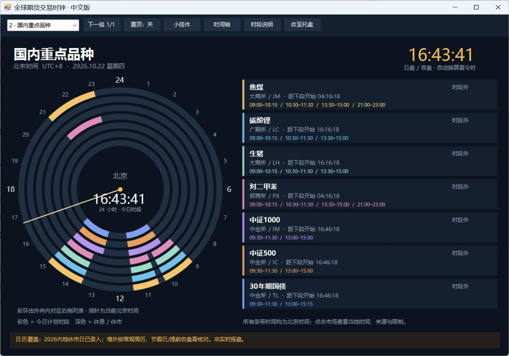

[下载 Windows v1.2 程序包](https://github.com/Domokira/GlobalFuturesClock/releases/latest)

# 全球期货交易时钟 · 中文版 v1.2
双击“全球期货交易时钟.exe”或“启动中文交易时钟.lnk”运行。程序与 markets.json 放在同一目录。
## 三个页面
顶部左侧下拉框切换：
1. 黄金交易时间：上海黄金期货、COMEX标准黄金、大阪标准黄金、港交所黄金、印度MCX黄金；另列上金所Au99.99现货供对照。
2. 国内重点品种：焦煤JM、碳酸锂LC、生猪LH、对二甲苯PX、中证1000股指IM、中证500股指IC、30年期国债TL，固定此顺序。TL常规日盘09:30—11:30、13:00—15:15，无夜盘。
3. 自选期货：点“选择品种”，搜索中文名或代码，也可按交易所筛选。勾选不会因搜索或切换交易所丢失；保存后写入 settings.json，下次启动保留。超过7个按“下一组”翻页。清空后可再次添加。
## 国内目录
核对日期2026-10-22。内地六所91个期货品种：上期所20、上期能源5、大商所26、郑商所27、广期所5、中金所8。含三种化工品月均价期货；不含期权、境外合约或每个交割月份。目录包括已上市但可能不活跃的品种；展示常规时间不表示当前存在可成交合约。后续新增上市不会自动联网更新。
完整目录见“国内品种目录.md”；每个品种来源及常规时间保存在 markets.json。
## 显示与操作
所有环形条带和时间轴均为北京时间，跨午夜切分；卡片与彩环由外向内对应。同组七个以内使用不同颜色。点击名称或卡片查看当地时间、时段来源与限制。
保留置顶、小挂件、时间轴、托盘。关闭窗口即退出；收至托盘后双击托盘图标恢复。
## 日历限制
自动换算境外夏令时。内地已录入2026节假日并屏蔽节前夜盘，境外仅常规周历。临时停市、节假日特殊交易、提前收盘、集合竞价和最后交易日特殊规则需核对交易所公告。2027及以后内地节假日未录入。本工具为交易时间参考，不提供实时行情/开市确认。
## 目录与规则核对来源
- 上期所：https://www.shfe.com.cn/services/calenderandholidays/tradinghours/
- 郑商所2026年3月品种报告：https://www.czce.com.cn/cn/content_file/jysj/ydscbg/2026/3/d2fcd9faa7834956874967667f0e8dfe.pdf
- 广期所：https://www.gfex.com.cn/gfex/sspzb/sspz.shtml
- 中金所：https://www.cffex.com.cn/
- 长江期货交易须知（交易时间补充核对）：https://www.cjfco.com.cn/main/customerservice/tradingguide/jyxz/index.shtml
- 三个化工品月均价上市通知：https://www.doto-futures.com/gsgga/23532.html
- 其他市场原始来源见各卡片时段说明。
## 验证
build.ps1重新构建；程序 --test 运行时段规则检查，结果见 test-results.txt。已检查跨日、收盘边界、节前夜盘、夏冬令时、91品种唯一性、重点品种夜盘及股指/国债收盘区别；并实际验证搜索、勾选和保存。

