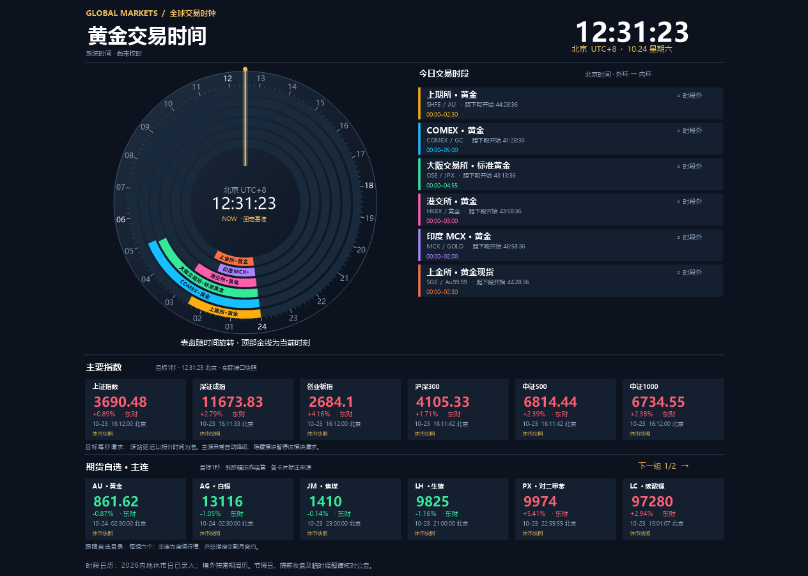

# 全球期货交易时钟 v1.4

[下载 Windows v1.4](https://github.com/Domokira/GlobalFuturesClock/releases/download/v1.4/GlobalFuturesClock-v1.4-windows.zip)

双击同目录的“全球期货交易时钟.exe”运行。先退出已运行的旧版本；程序保留单实例限制。markets.json 需与程序同目录。

## 这版修改
- 时区联动：顶部时间、24小时表盘刻度、中心时钟、当日交易色带、时间轴、交易卡片及详情中的当日时段统一跟随所选时区。
- 支持北京、东京、伦敦、纽约、UTC。按所选地区的自然日裁切交易区间，处理夏令时跳过与重复小时。
- 固定 NOW 金线模式下，当前时刻始终在顶部；同一真实交易时段相对 NOW 的角度可能保持不变，但刻度与日期边界会随时区变化。
- 色带标签使用像素字体与实际字宽，按可用弧长裁短，且裁剪在色带扇形内。短色带不强行放字；完整名称保留在卡片中。
- 指数与自选期货目标每 1 秒发起一轮请求，后台异步、无重叠请求；慢网时等上轮完成，不能保证源站每秒更新，更不等同于逐笔推送。
- 新增一排自选期货主连报价，跟随“自选品种”的选择，每组六个；点击报价行右上角“下一组”翻页。
- 两行行情均可在“显示设置”中独立隐藏；小挂件、最小化和收至托盘时暂停行情轮询。

## 行情源与冗余
- 主源：东方财富，统一读取指数与期货主连。
- 指数备用：腾讯财经。
- 期货备用：新浪财经。
- 主源请求失败、缺项，或已知交易时段内源站时间落后超过15秒时，尝试对应备用源。比较源站时间，避免较旧数据覆盖较新快照。
- 主源请求整体失败后，15秒内使用备用源并等待主源重试；行情面板标注异常与缺项。
- 卡片显示当前来源、源站返回时间（北京时间）、涨跌幅；期货涨跌幅按上一结算价。非交易时段保留快照；接口缺失不显示虚假的零价格。
- 期货主连是连续行情，不是指定交割月份的可下单合约。部分新上市或特殊品种可能暂无映射/有效报价，界面会明确提示。
- 本次选用东财而非金十作为冗余方案的一部分。网站行情端点无需密钥，但没有确认其长期可用性、免费授权或再分发权，可能限流、变更或延迟。

主要端点：
- https://push2.eastmoney.com/api/qt/ulist.np/get
- https://qt.gtimg.cn/
- https://hq.sinajs.cn/

## 保留功能
黄金、国内重点、自选三个页面；国内六所91品种目录；置顶、小挂件、托盘；显示设置记忆；程序内NTP校时。
NTP启动时、每30分钟自动同步，也可手动校时，仅校正应用时钟，不修改Windows系统时间。

## 规则范围
交易日历沿用 v1.2，仅录入2026内地休市日；境外为常规周历。节假日特殊时段、提前收盘、临时变更和最后交易日规则需另核对。源站时间可能是源站更新时间，不代表逐笔成交时刻。

## 验证与源码
42项离线检查通过：原交易规则21项、v1.3的11项、v1.4新增10项。新增覆盖时区裁日、夏令时、主源故障/旧报价切换、休市不误触发、期货映射、昨结算涨跌幅、缺失价格。
实网检查4项通过：东财指数与六所期货、腾讯备用、新浪商品及金融期货、强制主源故障后的真实备用接管。测试当日休市，未验证盘中持续跳价。

- Clock.cs：主窗体、交易规则、自选目录。
- Dashboard.cs：绘图、时区选择、1秒目标刷新及模块开关。
- MarketView.cs：UTC交易区间投影到所选时区自然日。
- Services.cs：NTP与腾讯解析。
- LiveFeed.cs：东财/新浪解析、期货映射与冗余路由。
- build.ps1：构建正式程序。
- Validation.cs、Validation14.cs：独立验证入口，测试记录随程序包提供。

